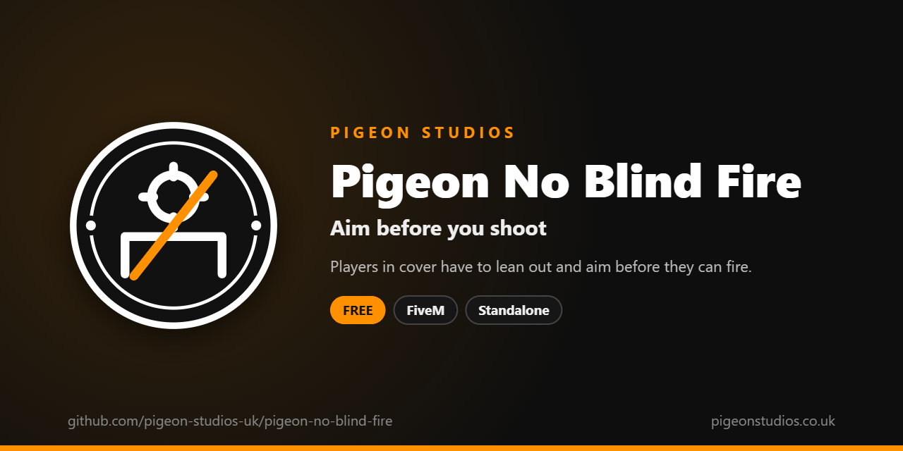

<div align="center">
  

  <h1>Pigeon No Blind Fire</h1>

  <p><strong>Stops players shooting blind from cover: they have to aim out before they can fire.</strong></p>

  <p>
    <a href="https://github.com/pigeon-studios-uk/pigeon-no-blind-fire/releases/latest"></a>
    <a href="LICENSE.md"></a>
    <a href="https://discord.gg/2NFVWEUmDF"></a>
    
  </p>

  <p>
    <a href="https://github.com/pigeon-studios-uk/pigeon-no-blind-fire/releases/latest"><strong>Download</strong></a> ·
    <a href="#installation">Install</a> ·
    <a href="#configuration">Configure</a> ·
    <a href="CHANGELOG.md">Changelog</a> ·
    <a href="https://discord.gg/2NFVWEUmDF">Support</a>
  </p>
</div>

---

## Contents

- [Overview](#overview)
- [Features](#features)
- [What players see](#what-players-see)
- [Requirements](#requirements)
- [Installation](#installation)
- [Updating](#updating)
- [Configuration](#configuration)
- [Localisation](#localisation)
- [How it works](#how-it-works)
- [Update checker](#update-checker)
- [Performance](#performance)
- [Security](#security)
- [Troubleshooting](#troubleshooting)
- [FAQ](#faq)
- [Support](#support)
- [Contributing](#contributing)
- [Licence](#licence)
- [Credits](#credits)

## Overview

Pigeon No Blind Fire is a free resource by [Pigeon Studios](https://pigeonstudios.co.uk) that turns off GTA's blind fire. In GTA, a player in cover can hold their weapon over or around the wall and shoot without looking, while staying almost completely hidden. On roleplay and tactical servers that makes gunfights one-sided and unrealistic.

With this resource, a player in cover has to aim out of it first, showing themselves, before they can shoot. Taking cover, moving along cover and aiming from cover all work exactly as before.

## Features

- **No shooting without aiming.** Firing, throwing and melee attacks are blocked while a player is in cover and not aiming.
- **Aiming works as normal.** Hold aim to lean out of cover, and shoot as usual.
- **No delay.** It's checked every frame while a player is in cover, so letting go of aim blocks shooting straight away.
- **Tells players why.** A short message says to aim first, at most once every few seconds. Uses ox_lib notifications if you have it, otherwise GTA's own.
- **Configurable.** Choose which controls are blocked, and whether players get a message.
- **23 languages.** The message is in `locales/`, and it follows ox_lib's language setting.
- **Standalone.** No framework or other resources needed.

## What players see

A player in cover who presses fire without aiming doesn't shoot, and sees:

```text
Cover
Aim out of cover before you shoot.
```

Once they hold aim and lean out, they can shoot normally.

## Requirements

| Requirement | Version | Notes |
|---|---|---|
| FXServer | A [recommended artifact](https://runtime.fivem.net/artifacts/) | |
| [ox_lib](https://github.com/communityox/ox_lib) | Optional | Used for the message if it's running |

**Frameworks:** none needed. It works the same on standalone servers, ESX Legacy, QBCore, Qbox and ox_core.

## Installation

1. **Download** `pigeon-no-blind-fire.zip` from the [latest release](https://github.com/pigeon-studios-uk/pigeon-no-blind-fire/releases/latest). Don't use the green **Code** button; release zips are the tested builds.
2. **Extract** it into your server's `resources` folder. The folder must be called `pigeon-no-blind-fire`.
3. **Start it** by adding this to `server.cfg`, after ox_lib if you use it:

   ```cfg
   ensure pigeon-no-blind-fire
   ```

4. **Configure** it in `configuration/config.lua` if you want to change anything. The defaults work as they are.
5. **Restart** your server. The console shows one line from the update checker:

   ```text
   [Pigeon Studios] Pigeon No Blind Fire v1.0.0 is up to date.
   ```

## Updating

1. Read the [changelog](CHANGELOG.md) for every version between yours and the latest, especially any **Upgrade notes**.
2. Back up your `configuration/` and `locales/` folders.
3. Replace the `pigeon-no-blind-fire` folder with the new release.
4. Copy your changed settings into the new `configuration/config.lua`. Don't copy the old file over the new one; new versions can add settings.
5. Restart the resource.

## Configuration

All settings are in `configuration/config.lua`, each explained by a comment next to it.

| Setting | Default | What it does |
|---|---|---|
| `Config.Locale` | `'auto'` | Language: `'auto'` follows ox_lib's language, or a code from `locales/` such as `'de'` |
| `Config.BlockedControls` | `{ 24, 257, 142 }` | GTA controls blocked in cover without aiming: attack, the second attack input, and the melee attack on the same button. The full list is in the [FiveM controls reference](https://docs.fivem.net/docs/game-references/controls/) |
| `Config.ShowMessage` | `true` | Tell players to aim first when they try to shoot |
| `Config.MessageCooldown` | `4` | Seconds between messages |
| `Config.Notifications` | `'auto'` | `'auto'` (ox_lib if it's running, otherwise GTA's notification feed), `'ox_lib'` or `'gta'` |

## Localisation

Pigeon No Blind Fire comes in 23 languages: `en` English, `cs` Czech, `da` Danish, `de` German, `es` Spanish, `et` Estonian, `fi` Finnish, `fr` French, `hr` Croatian, `hu` Hungarian, `id` Indonesian, `it` Italian, `nl` Dutch, `no` Norwegian, `pl` Polish, `pt` Portuguese, `pt-br` Brazilian Portuguese, `ro` Romanian, `sl` Slovenian, `sv` Swedish, `tr` Turkish, `zh-cn` Simplified Chinese and `zh-tw` Traditional Chinese. They're the languages ox_lib ships, so your server may already have one set.

With `Config.Locale = 'auto'` (the default), it uses ox_lib's language, so one line in `server.cfg` sets it for this and every other resource that follows ox_lib:

```cfg
setr ox:locale "de"
```

Use `setr`, not `set`, so players' games get it too. Without it, or for a language that isn't in `locales/`, the text is English. To choose a language for this resource only, set `Config.Locale` to its code, such as `'fr'` or `'pt-br'`.

Chinese text can show as blank in GTA's own text, such as its notifications and help messages, because GTA only loads its Chinese font when the game itself is set to Chinese. ox_lib's notifications show every language.

Every file was checked for missing text and placeholders, but not every translation has been read by a native speaker yet. If something reads wrong, please send a fix; see [Contributing](#contributing). To add a language, copy `locales/en.lua` to a new file named with the language's code (such as `ja.lua`), change `Locales.en` at the top to match (`Locales.ja`), and translate the text in quotes.

## How it works

Four times a second, the resource checks whether the player is in cover. While they are, it checks every frame whether they're aiming, either leaning out of cover or free-aiming. If they aren't, the controls in `Config.BlockedControls` are disabled for that frame, so pressing them does nothing. The game's own cover, peeking and aiming are left alone.

It only affects the player's own character, so every player needs it running, which FiveM does automatically for client scripts.

## Update checker

When it starts, Pigeon No Blind Fire checks our public [version registry](https://github.com/pigeon-studios-uk/pigeon-versions) once and prints one line in the server console saying whether it's up to date. If there's an update, it shows what's new and where to get it. The check is a single request to GitHub and sends nothing about your server or players.

Control it for every Pigeon Studios resource at once in `server.cfg`:

```cfg
set pigeon_update_check "on"      # default: one line per resource
set pigeon_update_check "quiet"   # only when there's an update or a problem
set pigeon_update_check "off"     # never check
```

## Performance

Outside cover it checks four times a second and does nothing else. In cover it runs every frame, which costs very little: three control checks and two aiming checks. Nothing runs on the server apart from the update check at start-up.

## Security

- It runs only in each player's own game and only blocks that player's own controls.
- It has no commands, exports or network events, so there is nothing other players, other resources or the server can send it.
- The only network request is the update check at start-up, from the server to GitHub. It sends nothing about your server or players.
- It sends notifications through ox_lib's local `ox_lib:notify` event when ox_lib is running. Nothing leaves the player's game.
- Like every rule that runs in the player's game, a player with a modified game could get around it. It's a gameplay rule, not an anti-cheat; pair it with your anti-cheat if that matters on your server.

Found a problem? Please don't open a public issue. Use the **Report a vulnerability** button in this repository's **Security** tab, or follow our [Security Policy](https://github.com/pigeon-studios-uk/.github/blob/main/SECURITY.md).

## Troubleshooting

**Players can still blind fire.**
Check the resource is started (`ensure pigeon-no-blind-fire`) and there are no errors in the F8 console. If your server uses custom keybinds that shoot with a different control, add that control's ID to `Config.BlockedControls`.

**Players can't shoot even while aiming from cover.**
Another resource may be blocking aiming or shooting. Stop this resource and test again to see if the problem goes away.

**The message shows in GTA's feed, not ox_lib.**
Start ox_lib before `pigeon-no-blind-fire`, or set `Config.Notifications = 'ox_lib'`.

**The console says "isn't in the version registry" or "couldn't check for updates".**
Your server couldn't reach GitHub, or the check is blocked by a firewall. The resource works normally either way. Turn the check off with `set pigeon_update_check "off"`.

## FAQ

**Is it really free?**
Yes. Use it on as many servers as you like, including ones that take donations. You just can't reupload, resell or bundle it. See [Licence](#licence).

**Does it stop players using cover?**
No. Taking cover, moving along it, switching sides and aiming out of it all work as normal.

**Does it affect NPCs?**
No. It only changes what players can do.

**Does it work with my framework?**
It doesn't use one, so yes.

## Support

Read [Troubleshooting](#troubleshooting) first, then ask in the support channels of our [Discord](https://discord.gg/2NFVWEUmDF). Please include your Pigeon No Blind Fire version, FXServer artifact and any errors from the console. See [Getting help](https://github.com/pigeon-studios-uk/.github/blob/main/SUPPORT.md).

Found a bug? Open a [bug report](https://github.com/pigeon-studios-uk/pigeon-no-blind-fire/issues/new/choose).

## Contributing

Fixes, improvements and translations are welcome. Please read the [contributing guide](https://github.com/pigeon-studios-uk/.github/blob/main/CONTRIBUTING.md) first, and open a feature request before working on anything big.

## Licence

Pigeon No Blind Fire is free to use under the **[Pigeon Studios Free Licence](LICENSE.md)**.

- ✅ Use it on any number of servers, including monetised ones
- ✅ Change it for your own servers
- ✅ Show it in videos and streams
- ❌ Don't reupload, share or mirror the files; link to this repository instead
- ❌ Don't sell it, bundle it in packs, or put it behind escrow
- ❌ Don't remove the credits

This summary isn't the licence; [LICENSE.md](LICENSE.md) is. Third-party notices are in [NOTICE.md](NOTICE.md).

## Credits

Made by [Pigeon Studios](https://pigeonstudios.co.uk).

<sub>Not affiliated with or endorsed by Rockstar Games, Take-Two Interactive or Cfx.re.</sub>
